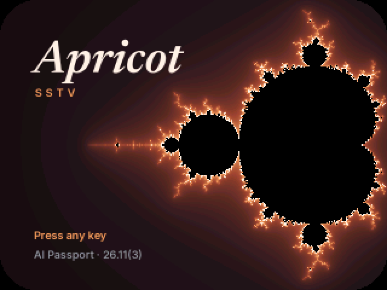
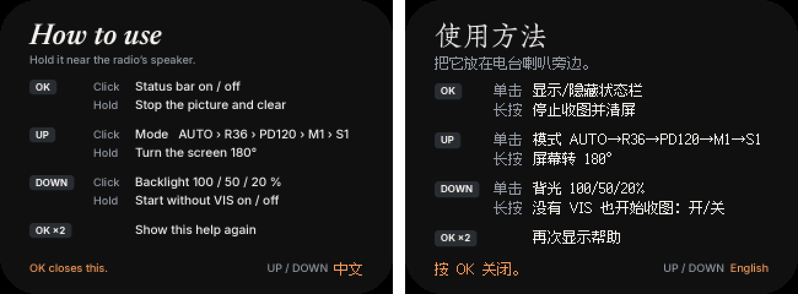
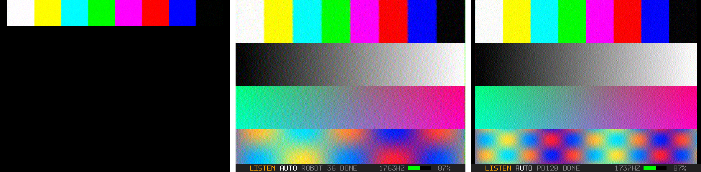

<p align="right"><a href="README.zh_CN.md">简体中文</a> · <strong>English</strong></p>

# Apricot SSTV for AI Passport





Apricot SSTV's receiver on the **FoloToy AI Passport** (ESP32-C3, 240×320
ST7789, ES8311 codec, three keys). Hold it near the radio's speaker: it
listens through its own microphone and draws each picture line by line,
straightened as it goes.

It is the decoder of the [iPhone/Watch app](https://github.com/SodaGray/apricot-sstv-apple),
made to fit a chip with no FPU and about 300 KB of RAM, and it decodes the
same 14 modes: Robot 36/72, Martin M1/M2, Scottie S1/S2/DX and PD50 to PD290.

- Starts from the VIS header (and corrects the tuning offset it measures), or
  from the line syncs alone when the VIS was missed.
- Fits the sender's clock and straightens the lines already drawn.
- Carries a picture through fades and lost syncs.
- Works offline: no Wi-Fi, no Bluetooth, no account.

Version **26.11(3)** (6 November 2026).



<sub>Screens from the host simulation (`host/sim_app`), which runs the
firmware's own `main/app_main.c`.</sub>

## Install

### Without a toolchain

Every push builds the firmware on GitHub Actions. Open the latest run of the
**build** workflow, download `apricot-sstv-passport-firmware`, and write
`apricot-sstv-passport-full.bin` with FoloToy's
[web flasher](https://ai-passport.folotoy.cn/tools/web-flasher/): connect the
Passport by USB, pick the file, write from `0x0`.

### Building it

You need ESP-IDF **v5.5.x** (the BSP asks for `>=5.5.3,<5.6.0`); Linux on
ARM64 (a Jetson, a Raspberry Pi) works as well as x86-64.

```sh
git clone --recursive https://github.com/SodaGray/apricot-sstv-passport.git
cd apricot-sstv-passport
. $IDF_PATH/export.sh
idf.py set-target esp32c3
idf.py build flash monitor
```

The Passport shows up as `/dev/ttyACM0` on Linux (its own USB serial).

## Use

The boot splash stays until you press a key. Then the key help comes up, in
English or Chinese: UP or DOWN switches the language, OK closes it. The
Passport is already listening by then, and a picture that starts closes the
help by itself.

| Key  | Click | Hold | Double click |
|------|-------|------|--------------|
| OK   | status bar on / off | stop the picture and clear the screen | the key help again |
| UP   | receive mode: AUTO → R36 → PD120 → M1 → S1 | turn the screen 180° | |
| DOWN | backlight 100 / 50 / 20 % | start without VIS on / off | |

The receive mode starts at AUTO on every boot; the screen turn, backlight,
start-without-VIS and the help's language are remembered. The help doesn't
open over a picture coming in, and opening it clears what was on the screen
(the Passport keeps no copy of it).

The status bar hides itself when a picture starts, so the whole picture is in
view, and comes back when it ends. It shows the state, the mode (with lines
received, and the clock error once it is known), the tone the decoder hears,
a level meter and the battery. Green on the meter is right; red is clipping:
turn the radio down.

For a picture of a known mode, such as the ISS's Robot 36, lock the mode with
UP: a VIS for anything else then starts nothing.

The screen runs in landscape, 320×240. Robot 36 fills it pixel for pixel;
Martin and Scottie (320×256) show at 300×240, PD120/180/240 at 309×240, PD290
at 311×240.

Nothing is saved: the Passport has no room to keep a picture, only the
screen shows it. Record the audio with the iPhone app if you want the picture.

## Inside

`main/sstv_dsp.c` is a copy of the iPhone/Watch decoder, made for the C3:

- **Integer per sample.** The high-pass (Q29 biquads), the mixer (an exact
  table of one period of the 1700 Hz LO), the low-pass FIR (Q15 taps on Q4
  data), the FM discriminator and its atan2 (a 257-entry table), the tone
  stream (1/16 Hz), the VIS bins and the picture sampling (Q16 positions) are
  all integer. Float and double remain only where they run once a line or
  less.
- **No picture buffer.** Rows go to the app through an `SstvSink` callback at
  the size sent, and the app draws them straight to the panel, without LVGL.
  Robot 36 keeps a small ring of Y and chroma lines to pair its colour lines.
- **Shorter memory.** The level ring is 64 KB (4.1 s at 16 kHz): older lines
  keep the timing they were drawn with, as on the iPod. The tone history is
  32 KB.

The decoder takes about 141 KB at 16 kHz, the app another 17 KB for row
buffers and the status bar.

`main/app_main.c` is the rest: one task reads the microphone, feeds the
decoder, draws the rows and runs the keys.

### Splash and key help

The splash is an apricot Mandelbrot set behind the "Apricot" wordmark, after
the iPhone/Watch app's icon. It and the two help pages are 320×240 images,
`main/splash.rgb565`, `main/help_en.rgb565` and `main/help_zh.rgb565` (raw
RGB565, high byte first, 150 KB of flash each), embedded with `EMBED_FILES`.
They are made with numpy, Pillow and these OFL fonts:

- Newsreader Italic and Inter, from [google/fonts](https://github.com/google/fonts)
  (`ofl/newsreader/Newsreader-Italic[opsz,wght].ttf`, `ofl/inter/Inter[opsz,wght].ttf`);
- Zhuque Fangsong (朱雀仿宋), from [TrionesType/zhuque](https://github.com/TrionesType/zhuque)
  releases, for the Chinese title;
- Ark Pixel Font (方舟像素字体) 12 px, the glyph folder
  `assets/glyphs/12/cmap` of [TakWolf/ark-pixel-font](https://github.com/TakWolf/ark-pixel-font),
  for the Chinese text, drawn pixel for pixel.

```sh
python3 tools/make_splash.py --serif Newsreader-Italic.ttf --inter Inter.ttf \
    --version '26.11(3)' --out main/splash.rgb565 --preview splash.png
python3 tools/make_help.py --serif Newsreader-Italic.ttf --inter Inter.ttf \
    --cjk ZhuqueFangsong-Regular.ttf --pixel ark-pixel-font/assets/glyphs/12/cmap \
    --out-en main/help_en.rgb565 --out-zh main/help_zh.rgb565 --preview help.png
```

The version is also in `main/version.h` and `CMakeLists.txt` (`PROJECT_VER`).

## Host checks

`host/` builds with any C compiler, without ESP-IDF, and runs on GitHub
Actions too:

```sh
cd host
make test                     # add APPLE_CORE=<apricot-sstv-apple>/Shared/Core to compare with the float decoder
```

- `bench_port` encodes 17 cases with the Apricot test encoder (`enc.c`):
  every mode family, clock skew, tuning offset, noise down to 10 dB SNR,
  fading, no VIS, input peaks from 40 to 32000. It decodes them and scores
  luma PSNR against what an ideal decoder gives.
- `bench_orig` (with `APPLE_CORE`) runs the same cases through the
  iPhone/Watch float decoder: the two agree within 0.3 dB on every case.
- `sim_app` links the real `main/app_main.c` against stand-ins for the
  ESP-IDF headers and a simulated panel, microphone and keys (ASan and UBSan
  on), presses its way through the splash and the help, plays Martin M1 then
  Robot 36 into it and writes the screens to `out/`.

## License

GPL-3.0-only, like Apricot SSTV. Third-party parts are listed in
[NOTICE.md](NOTICE.md); the BSP in `third_party/ai-passport` is FoloToy's,
under the MIT license.

Apricot SSTV © 苏打灰 (SodaGray) · <https://bd1fpn.cn/>
