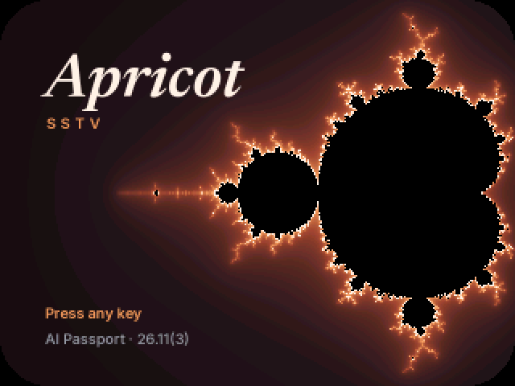
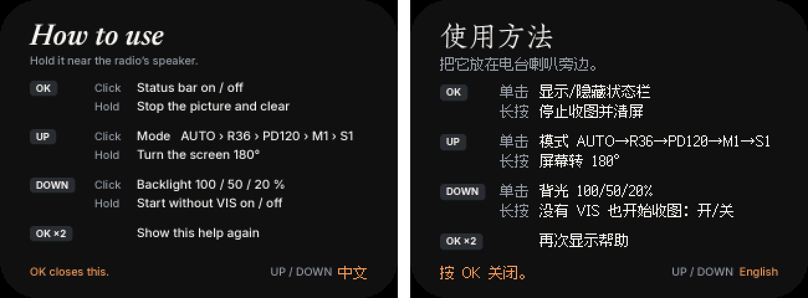
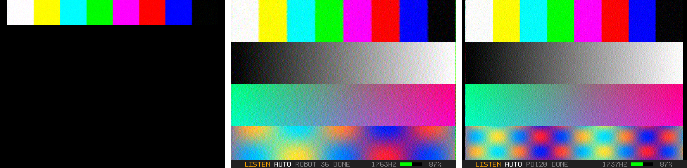

<p align="right"><strong>简体中文</strong> · <a href="README.md">English</a></p>

# Apricot SSTV for AI Passport





把 Apricot SSTV 的接收功能装进 **FoloToy AI Passport**（ESP32-C3，240×320 ST7789 屏幕，ES8311 音频编解码器，三个按键）。把它放在电台喇叭旁边，它用自己的麦克风收听，一行一行地画出图像，边收边校正倾斜。

解码器来自 [iPhone/Watch 版](https://github.com/SodaGray/apricot-sstv-apple)，改造后能在没有浮点单元、只有约 300 KB 内存的芯片上运行，支持同样的 14 种模式：Robot 36/72、Martin M1/M2、Scottie S1/S2/DX，以及 PD50 到 PD290。

- 听到 VIS 头就开始收图，并按测得的频偏自动修正；漏掉 VIS 时，也能只凭行同步脉冲开始收图。
- 拟合发送方的时钟误差，并把已经画好的行重新校直。
- 信号衰落、同步脉冲丢失时，图像能接着收下去。
- 完全离线：不需要 Wi-Fi、蓝牙或账号。

版本 **26.11(3)**（2026 年 11 月 6 日）。



<sub>截图来自主机上的模拟程序（`host/sim_app`），它运行的就是固件本身的 `main/app_main.c`。</sub>

## 安装

### 不装工具链

每次推送代码，GitHub Actions 都会自动编译固件。打开 **build** 工作流最近一次的运行记录，下载 `apricot-sstv-passport-firmware`，然后用 FoloToy 的[网页烧录工具](https://ai-passport.folotoy.cn/tools/web-flasher/)写入：用 USB 连接 Passport，选择 `apricot-sstv-passport-full.bin`，从地址 `0x0` 开始写入。

### 自己编译

需要 ESP-IDF **v5.5.x**（BSP 要求 `>=5.5.3,<5.6.0`）。ARM64 的 Linux（Jetson、树莓派）和 x86-64 一样能用。

```sh
git clone --recursive https://github.com/SodaGray/apricot-sstv-passport.git
cd apricot-sstv-passport
. $IDF_PATH/export.sh
idf.py set-target esp32c3
idf.py build flash monitor
```

在 Linux 上，Passport 会显示为 `/dev/ttyACM0`（芯片自带的 USB 串口）。

## 使用

开机画面会一直停留，直到按下任意键。之后显示按键帮助，有英文和中文两种：按 UP 或 DOWN 切换语言，按 OK 关闭。这时 Passport 已经在收听了，如果有图像开始传来，帮助页会自动关闭。

| 按键 | 单击 | 长按 | 双击 |
|------|------|------|------|
| OK   | 显示 / 隐藏状态栏 | 停止收图并清屏 | 再次显示帮助 |
| UP   | 切换接收模式：AUTO → R36 → PD120 → M1 → S1 | 屏幕旋转 180° | |
| DOWN | 背光 100 / 50 / 20 % | 没有 VIS 也开始收图：开 / 关 | |

每次开机，接收模式都从 AUTO 开始；屏幕方向、背光、“没有 VIS 也开始收图”以及帮助页的语言都会记住。正在收图时不能打开帮助页；打开帮助页会清掉屏幕上原有的图像（Passport 不保存屏幕内容）。

开始收图时状态栏会自动隐藏，让整幅图都露出来；收完后再出现。状态栏显示：当前状态，模式（附带已收行数，以及测出来的时钟误差），解码器听到的音调，电平表和电量。电平表显示绿色就合适；变红说明削波了，把电台音量调小。

已经知道对方用什么模式时（比如国际空间站常用的 Robot 36），按 UP 锁定这个模式，其他模式的 VIS 就不会触发收图。

屏幕横向显示，分辨率 320×240。Robot 36 正好铺满全屏，一个像素对一个像素；Martin 和 Scottie（320×256）缩放到 300×240，PD120/180/240 缩放到 309×240，PD290 缩放到 311×240。

图像不会被保存：Passport 没有足够的内存存下整幅图，只能显示在屏幕上。想留下图像的话，用 iPhone 版同时录下音频。

## 内部实现

`main/sstv_dsp.c` 是 iPhone/Watch 版解码器的一份拷贝，针对 C3 做了改造：

- **每个采样的计算全部用整数。** 高通滤波（Q29 双二阶滤波器）、混频（1700 Hz 本振一个完整周期的精确查找表）、低通 FIR（Q15 系数，Q4 数据）、FM 鉴频及其 atan2（257 项查找表）、音调流（单位 1/16 Hz）、VIS 统计和像素采样（Q16 位置）都是整数运算。浮点只留在每行运行一次或更少的地方。
- **没有图像缓冲区。** 每解出一行，就通过 `SstvSink` 回调按原始尺寸交给应用层，由应用直接画到屏幕上，不经过 LVGL。Robot 36 只保留一小段亮度和色度行的环形缓冲，用来给色度行配对。
- **记忆时间更短。** 电平环形缓冲为 64 KB（16 kHz 下约 4.1 秒），更早的行保持当时画下的时序，和 iPod 版一样。音调历史为 32 KB。

解码器在 16 kHz 下占用约 141 KB 内存，应用层的行缓冲和状态栏再占约 17 KB。

`main/app_main.c` 负责其余部分：一个任务读取麦克风、驱动解码器、绘制图像行、处理按键。

### 开机画面和按键帮助

开机画面是杏色的曼德博集合，衬着 “Apricot” 字样，与 iPhone/Watch 版的图标相呼应。它和两页帮助都是 320×240 的图片：`main/splash.rgb565`、`main/help_en.rgb565`、`main/help_zh.rgb565`（原始 RGB565 数据，高字节在前，每张占 150 KB Flash），通过 `EMBED_FILES` 编进固件。生成它们需要 numpy、Pillow 和以下 OFL 字体：

- Newsreader 斜体和 Inter，来自 [google/fonts](https://github.com/google/fonts)（`ofl/newsreader/Newsreader-Italic[opsz,wght].ttf`、`ofl/inter/Inter[opsz,wght].ttf`）；
- 朱雀仿宋，来自 [TrionesType/zhuque](https://github.com/TrionesType/zhuque) 的发布版本，用于中文标题；
- 方舟像素字体 12px，即 [TakWolf/ark-pixel-font](https://github.com/TakWolf/ark-pixel-font) 的字形目录 `assets/glyphs/12/cmap`，用于中文正文，逐像素绘制。

```sh
python3 tools/make_splash.py --serif Newsreader-Italic.ttf --inter Inter.ttf \
    --version '26.11(3)' --out main/splash.rgb565 --preview splash.png
python3 tools/make_help.py --serif Newsreader-Italic.ttf --inter Inter.ttf \
    --cjk ZhuqueFangsong-Regular.ttf --pixel ark-pixel-font/assets/glyphs/12/cmap \
    --out-en main/help_en.rgb565 --out-zh main/help_zh.rgb565 --preview help.png
```

版本号另外还写在 `main/version.h` 和 `CMakeLists.txt`（`PROJECT_VER`）里，修改时要一起改。

## 主机测试

`host/` 目录下的测试用任意 C 编译器就能编译，不需要 ESP-IDF，也会在 GitHub Actions 上运行：

```sh
cd host
make test                     # 加上 APPLE_CORE=<apricot-sstv-apple>/Shared/Core，可以同时和浮点版解码器对比
```

- `bench_port`：用 Apricot 的测试编码器（`enc.c`）生成 17 组音频，覆盖所有模式家族、时钟偏差、频偏、低至 10 dB 信噪比的噪声、信号衰落、没有 VIS，以及峰值从 40 到 32000 的输入电平。解码后计算亮度 PSNR，与理想解码器的结果对比。
- `bench_orig`（需要 `APPLE_CORE`）：把同样的音频交给 iPhone/Watch 版的浮点解码器。两者在每一组上都相差不到 0.3 dB。
- `sim_app`：把真正的 `main/app_main.c` 链接到 ESP-IDF 头文件的替身，以及模拟的屏幕、麦克风和按键上（开启 ASan 和 UBSan），依次按键通过开机画面和帮助页，再播放 Martin M1 和 Robot 36，把屏幕画面输出到 `out/`。

## 许可

与 Apricot SSTV 相同，采用 GPL-3.0-only。第三方组件列在 [NOTICE.md](NOTICE.md) 中；`third_party/ai-passport` 里的 BSP 属于 FoloToy，采用 MIT 许可。

Apricot SSTV © 苏打灰 (SodaGray) · <https://bd1fpn.cn/>
